---
lab:
  title: Get started with generative AI and agents in Microsoft Foundry
  description: Use Microsoft Foundry to deploy a generative AI model and create an agent.
  level: 200
  duration: 35 minutes
  islab: true
  primarytopics:
    - Microsoft Foundry
---

# Get started with generative AI and agents in Microsoft Foundry

<br/>**Hi, I'm Anton.**<br/>I'll be here to help you with hints and tips as you work through this lab, in which you'll deploy a generative AI model and create an agent.

If you want more interactive help, you can chat with me in the *[Ask Anton](https://aka.ms/choose-anton){:target="_blank"}* app.

<details>
<strong><i><a href="https://aka.ms/choose-anton" target="_blank">Ask Anton</a></i></strong> is a generative AI agent that can answer questions about AI concepts and Microsoft Foundry technologies. It's available in two versions at <code>https://aka.ms/choose-anton</code>:
<ul>
<li><strong>Azure-based</strong>: Best experience <i>(requires an Azure subscription and deployment of a model in a Foundry project)</i>.</li>
<li><strong>Browser-based</strong>: Use a small language model in your browser <i>(reduced functionality - may be slow or work only in "basic" mode in older/lower-spec devices)</i>.</li>
</ul>
<blockquote><i>Ask Anton is <u>not</u> a supported Microsoft product or a component of Microsoft Learn or AI Skills Navigator.</i>
</blockquote>
</details>
<hr/>

This lab should take approximately **35** minutes to complete.

> **Note**: Many components of Microsoft Foundry, including the Microsoft Foundry portal, are subject to continual development. This reflects the fast-moving nature of artificial intelligence technology. Some elements of your user experience may differ from the images and descriptions in this exercise!

## Create a Microsoft Foundry project

Microsoft Foundry uses *projects* to organize models, resources, data, and other assets used to develop an AI solution.

1. In a web browser, open [Microsoft Foundry](https://ai.azure.com){:target="_blank"} at `https://ai.azure.com` and sign in using your Azure credentials. Close any tips or quick start panes that are opened the first time you sign in, and if necessary use the **Foundry** logo at the top left to navigate to the home page.
1. If you do not have any existing projects, you may be prompted to create one. If so, create a new project with a unique name; expanding the  **Advanced options** area to specify the following settings for your project:
    - **Foundry resource**: *Enter a valid name for your AI Foundry resource.*
    - **Subscription**: *Your Azure subscription*
    - **Resource group**: *Create or select a resource group*
    - **Region**: Select any of the **AI Foundry recommended** regions in [this list](https://learn.microsoft.com/azure/foundry/openai/how-to/responses#supported-regions){:target="_blank"}

    > <br/>**Tip**: Depending on your permissions in the Azure subscription, you may need to clear the option to set up recommended resources.

1. Wait for your project to be created, and close any welcome dialogs that are displayed. It may take a few minutes. After creating or selecting a project in the new Foundry portal, it should open in a page similar to the following image:

    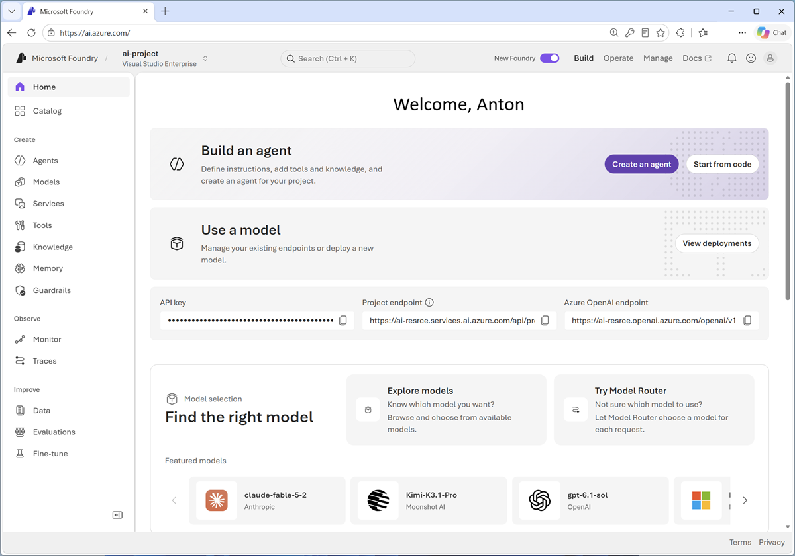

## Deploy a model

At the heart of every AI agent, there's a large language model (LLM). Let's find one in the Foundry models catalog.

1. Now you're ready to explore models. In the Navigation pane, select the **Catalog** page.

    Microsoft Foundry provides a large catalog of models, services, tools, and other assets that you can use in your AI apps and agents.

    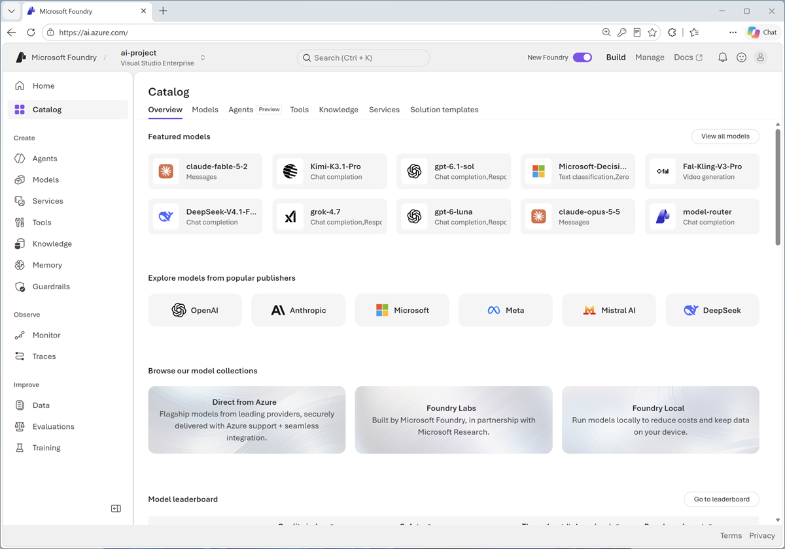


1. On the **Models** tab, search the catalog for the `gpt-5.4-mini` model, and view the page for this model, which describes its features and capabilities.

    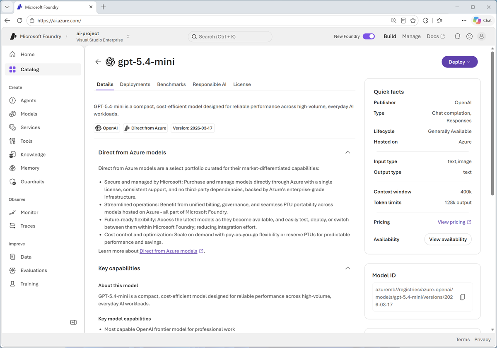

    
    > <br/>**Tip**: If you already have a *gpt* model deployment, you can use it instead of deploying a new one. Model availability in a project is subject to regional quotas. If you don't have enough quota to deploy the model in your project's region, you can use a different chat-enabled *gpt* model that supports chat completion. Alternatively, you can create a new project in a different region.

1. Use the **Deploy** button to deploy the model using the default settings. Deployment may take a minute or so. If deployment with the default settings fails, you can try using custom settings.

1. When the model has been deployed, view the model playground page that is opened, in which you can chat with the model.

    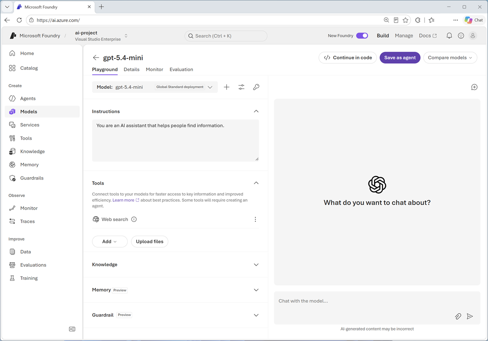

## Chat with the model

You can use the playground to explore the model by chatting with it.

1. Use the button at the bottom of the left navigation pane to hide it and give yourself more room to work with.
1. In the **Chat** pane, enter a prompt such as `Who was Ada Lovelace?`, and review the response.

    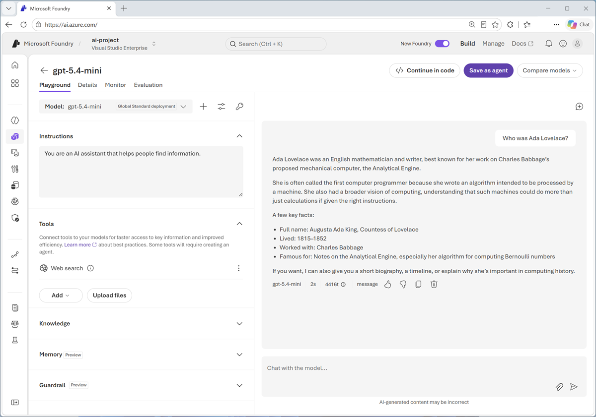

1. Enter a follow-up prompt, such as `Tell me more about her work with Charles Babbage.` and review the response.

    > <br/>**Tip**: Generative AI chat applications often include the conversation history in the prompt; so the context of the conversation is retained between messages. In this case, "her" is interpreted as referring to Ada Lovelace.

1. In the model playground, at the top-right of the chat pane, use the **New chat** button to restart the conversation and remove the conversation history.

    Let's try asking about the same subject with a more specific prompt.

1. Enter the prompt `List three facts about Ada Lovelace.` and review the response.

    The response should reflect the explicit instructions in the prompt.

    > <br>**Tip**: The difference in the response illustrates a key feature of using an LLM. LLM responses are generated dynamically by the model - not looked up in a static data source. On the one hand, this makes LLMs more flexible; but on the other hand it means that the response generated may not be *grounded* in authoritative facts. Later, we'll explore how to add a knowledge source to ground generative AI responses.

## Specify *instructions*

To support specific use cases, you should use a *system prompt* to provide the model with instructions that guide its responses. You can use the system prompt to give the model a specific focus or role, and provide guidelines about format, style, and constraints about what the model should and shouldn't include in its responses.

1. In the model playground, at the top right of the chat pane, use the **New chat** button to restart the conversation and remove the conversation history.
1. In the pane on the left, in the **Instructions** text area, change the system prompt to:

    ```
   You are an expert in the history of computing and AI. You only answer questions about significant people and events in the development of computing, and about notable vintage computers. Do not engage in conversations on any topic that is unrelated to computing history.
    ```

1. Enter a new prompt, such as `Tell me about ELIZA.` and view the response.
1. Continue the conversation with prompts such as `How does it compare with modern LLMs?`.
1. Try asking an "off-topic" question, such as `What's the capital of Spain?`; and view the response.

## Add a *web_search* tool

So far, the model has answered questions based on the data with which it was trained. While this is useful, that leaves out a lot of current information on the web; which might help the model give more relevant answers.

We can use *tools* to give models access to external data sources, and to perform custom tasks. Let's add a tool that enables the model to search the Web for up-to-date information.

1. In the pane on the left, under the instructions, expand the **Tools** section if it isn't already expanded.
1. In the **Add** drop-down list, ensure **Web search** is enabled.

    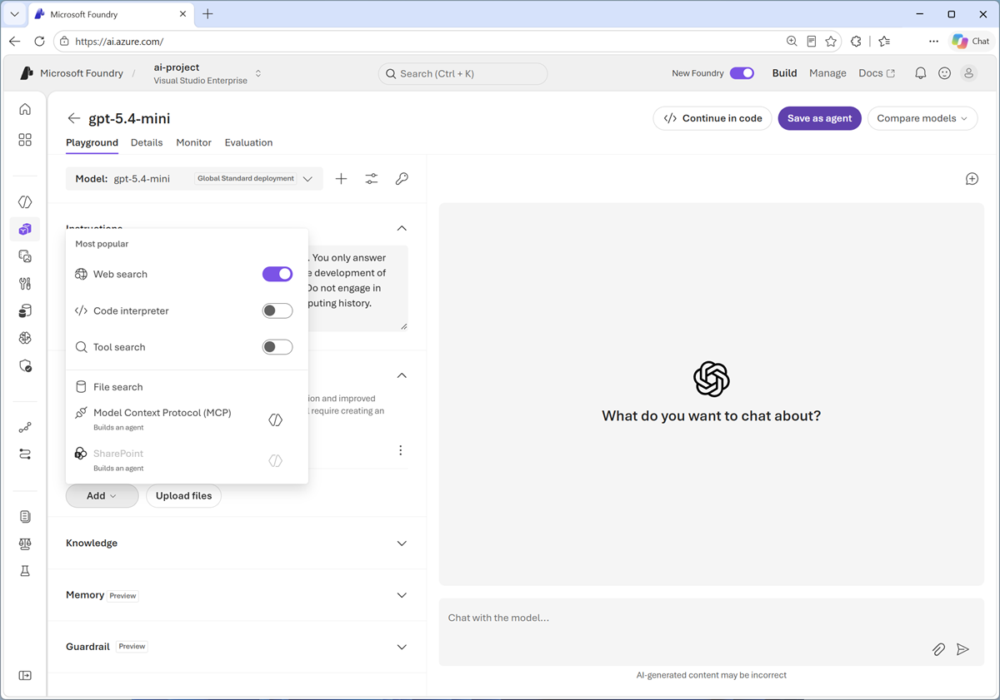

1. In the model playground, at the top right of the chat pane, use the **New chat** button to restart the conversation.
1. With the *web_search* tool listed in the pane on the left, in the chat pane, enter the prompt `Find a vintage computer store near Seattle` (*or your local city!*) and review the response.

    The model should have searched the Web for vintage computer stores near the specific city.

## Save the model configuration as an agent

While you can implement generative AI apps using a standalone model, to create a fully agentic AI experience, you need to encapsulate the model, its instructions, and its tool configuration in an *agent*. By encapsulating the instructions and tools in an agent, you can connect client applications to its endpoint without any need for them to specify a system prompt or implement their own *retrieval augmented generation* (RAG) logic to add contextual knowledge.

1. In the model playground, at the top right select **Save as agent**. Then, when prompted, name your new agent `computing-historian`.

    When the agent is created, it opens in a new playground specifically for working with agents.

    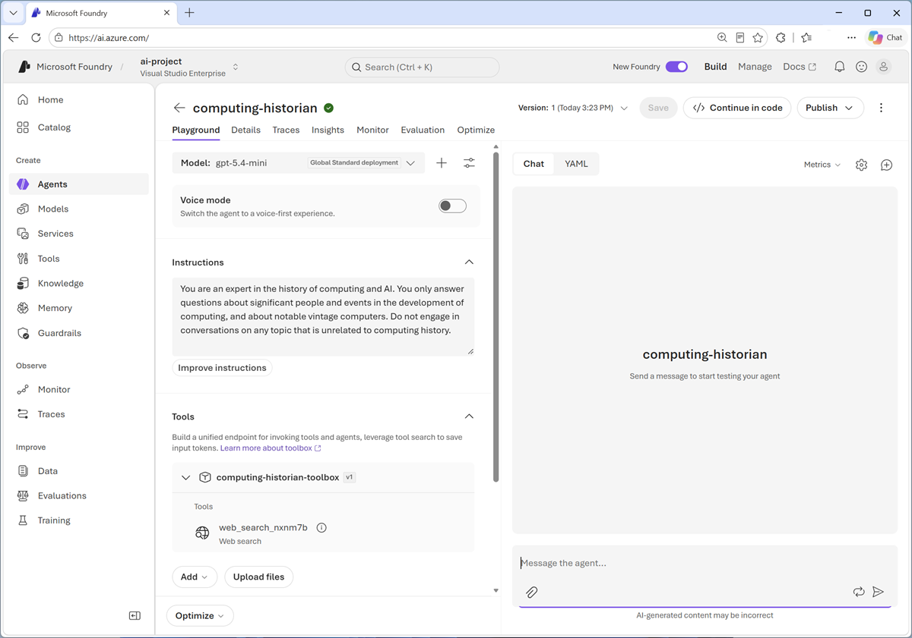

1. In the pane on the right, view the **YAML** tab, which contains the definition for your agent. Note that its definition includes the model, its parameter settings, and the instructions you specified - similar to this:

    ```yml
    metadata:
        logo: Avatar_Default.svg
        microsoft.voice-live.enabled: "false"
    object: agent.version
    id: computing-historian:1
    name: computing-historian
    version: "1"
    description: ""
    created_at: 1794957785
    definition:
    kind: prompt
    model: gpt-5.4-mini
    instructions: You are an expert in the history of computing and AI. You only answer questions about significant people and events in the development of computing, and about notable vintage computers. Do not engage in conversations on any topic that is unrelated to computing history.
    reasoning:
        effort: low
        summary: detailed
    tools:
        - type: mcp
        server_label: computing-historian-toolbox
        server_url: https://ai-resrce.services.ai.azure.com/api/projects/ai-project/toolboxes/computing-historian-toolbox/versions/1/mcp?api-version=v1
        require_approval: never
    draft: false
    status: active
    instance_identity:
    principal_id: e517e99b-17d6-4775-9abd-e72599d405f8
    client_id: e517e99b-17d6-4775-9abd-e72599d405f8
    blueprint:
    principal_id: 307951ec-c015-4fb1-9179-656142b90a1f
    client_id: c51771af-7be3-48c6-994e-14d5e12ba129
    blueprint_reference:
    type: ManagedAgentIdentityBlueprint
    blueprint_id: computing-historian-35dae
    agent_guid: 35daef3f-d8a8-473e-8ef3-d144b4e30397
    ```

1. Switch back to the **Chat** tab, and enter the prompt `Who are you?`

    The response should indicate that the agent is "aware" of its role as a computing historian.

## Preview the agent

Now you have a working agent, you can preview it in a basic web chat application.

1. At the top of the chat pane, in the **Publish** drop-down list, select **Preview web app**.

    A preview chat interface is opened in a new browser tab.

1. Enter a prompt, such as `What can you tell me about the Altair 8800?` and view the response from your agent.

    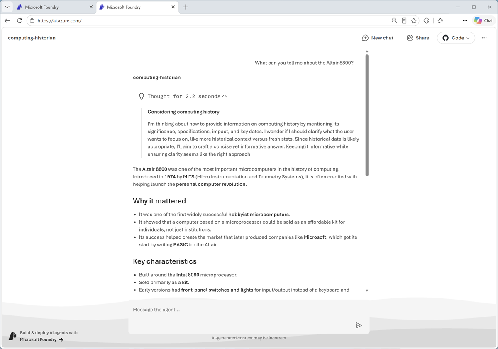

## View client code to access the agent in your project

The agent is defined within your Foundry project, and there's a convenient way to develop apps that connect to it there; allowing you to iteratively refine both the agent and the client app to create the solution you need.

1. In the agent playground, at the top of the chat pane, select **</> Continue in code**, and view the sample code for consuming the agent; which should be similar to this:

    ```python
    # Before running the sample:
    #    pip install "azure-ai-projects>=2.1.0"

    from azure.identity import DefaultAzureCredential
    from azure.ai.projects import AIProjectClient

    endpoint = "https://ai-resrce.services.ai.azure.com/api/projects/ai-project"
    agent_name = "computing-historian"
    user_message = "Hi computing-historian"

    with (
        DefaultAzureCredential() as credential,
        AIProjectClient(
            endpoint=endpoint,
            credential=credential,
            allow_preview=True,
        ) as project_client,
    ):
        # Bind the OpenAI client to the existing agent endpoint.
        openai_client = project_client.get_openai_client(agent_name=agent_name)

        # GitHub Copilot preview agents require a conversation for every Responses turn.
        conversation = openai_client.conversations.create()
        response = openai_client.responses.create(
            conversation=conversation.id,
            input=[{"role": "user", "content": user_message}],
        )

        print(f"Response output: {response.output_text}")
    ```

    The code to connect to your agent uses the **Azure.AI.Projects** library to create an **AIProjectClient** object connected to your Foundry project. Since this involves connecting to a project, which may contain privileged resources, key-based authentication is <u>not</u> supported, and the application must use an Entra ID identity to be authenticated.

    After connecting to the project, the code uses the project client's **get_openai_client** method to retrieve an OpenAI client object; with which it can submit prompts to the agent using the same **Responses** API we previously saw being used to chat with a model.

## Monitor agent activity and cost

After deploying a client application for your agent, users can submit prompts to generate responses and perform actions. You can monitor this activity and the costs it incurs.

### View metrics for the agent

1. In the page for your **computing-historian** agent, view the **Monitor** tab, and on the **Overview** tab, view overall metrics recorded for your agent.

    Note that some metrics require configuration of Azure AppInsights, but token usage (from which the cost of using the agent's model is derived) is shown (the estimated cost for the limited activity you've performed recently in this exercise may not yet be displayed).

    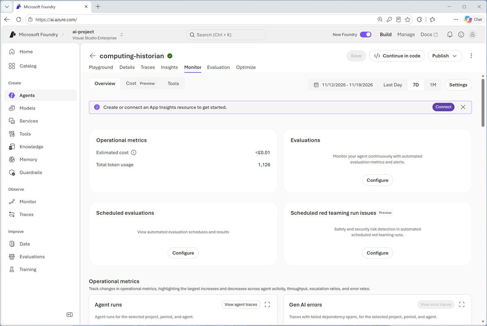

    > **Note**: Your metrics may be different to those in this image.

1. View the **Cost** tab, and within it, select the **Token usage** view.

    Here you can see the number of input and output tokens that have been processed by the agent each day.

    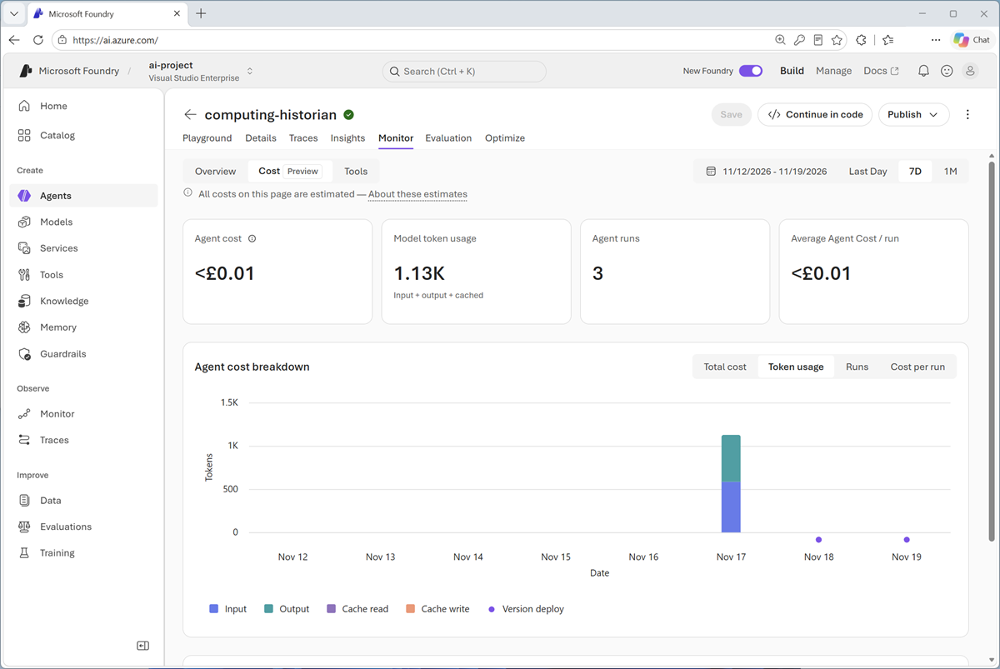

    > **Note**: Your metrics may be different to those in this image.

### View project metrics and cost control measures

1. In the navigation pane on te left, in the **Observe** section, select **Monitor**.

    This page shows overall metrics for the project.

    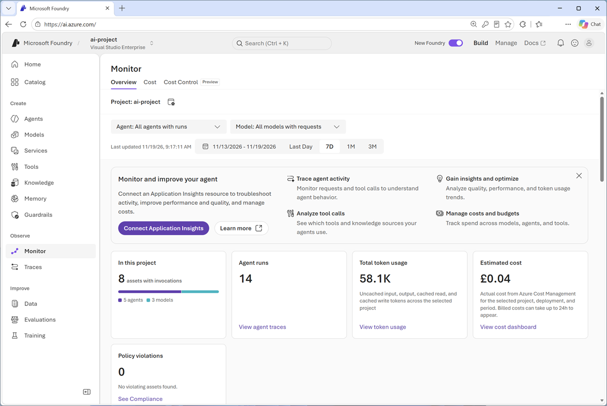

    > **Note**: Your metrics may be different to those in this image.

1. View the **Cost** tab, which shows overall costs for the project. Then view the **Cost Control** tab, in which you can create cost control policies to set spending thresholds for the project and individual agents.

    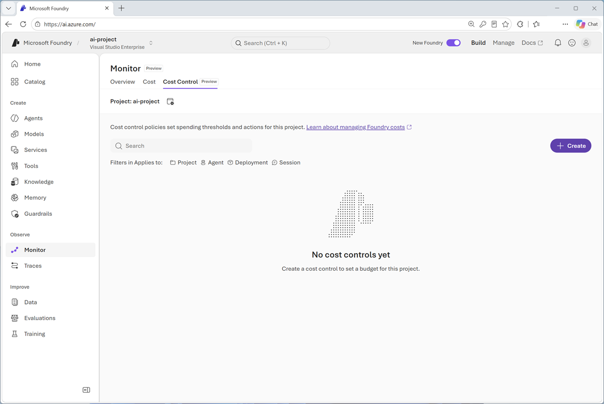

    > <br/>**Note**: Observability and cost management (sometimes referred to as *FinOps*) is a critical element of an agentic solution, and goes beyond token costs for individual agents (though that is an important consideration). See [Cost and FinOps in Microsoft Foundry](https://learn.microsoft.com/azure/foundry/concepts/manage-costs){:target="_blank"} for more information.

## Summary

In this exercise, you explored how to deploy and chat with a generative AI model in Microsoft Foundry portal. You then saved the model as an agent with instructions and tools.

The agent explored in this exercise is a simple example that demonstrates how quickly and easily you can get started with generative AI app and agent development using Microsoft Foundry. From this foundation, you could build a comprehensive agentic solution in which agents use tools to find information and automate tasks, and collaborate with one another to perform complex workflows.

## Clean Up

If you have finished exploring Microsoft Foundry, you should delete the resources created in this exercise to avoid unnecessary utilization charges.

1. Open the [Azure portal](https://portal.azure.com){:target="_blank"} at `https://portal.azure.com` and view the contents of the resource group where you deployed the project used in this exercise.
1. On the toolbar, select **Delete resource group**.
1. Enter the resource group name and confirm that you want to delete it.

> <br/>If you used the [*Ask Anton*](https://aka.ms/choose-anton){:target="_blank"} app during this lab, we'd love you to [tell us about your experience with it](https://forms.office.com/r/fC0ndfBQeK){:target="_blank"}!
