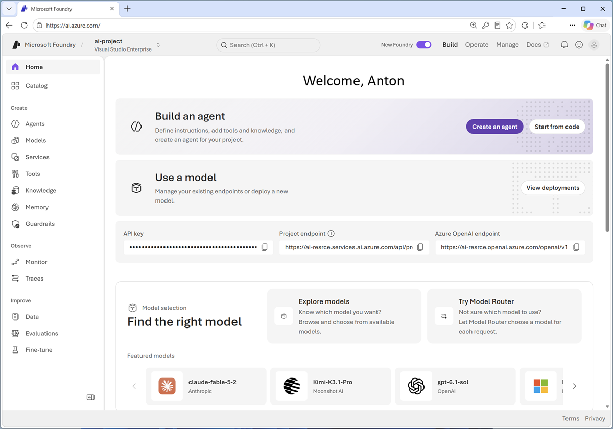
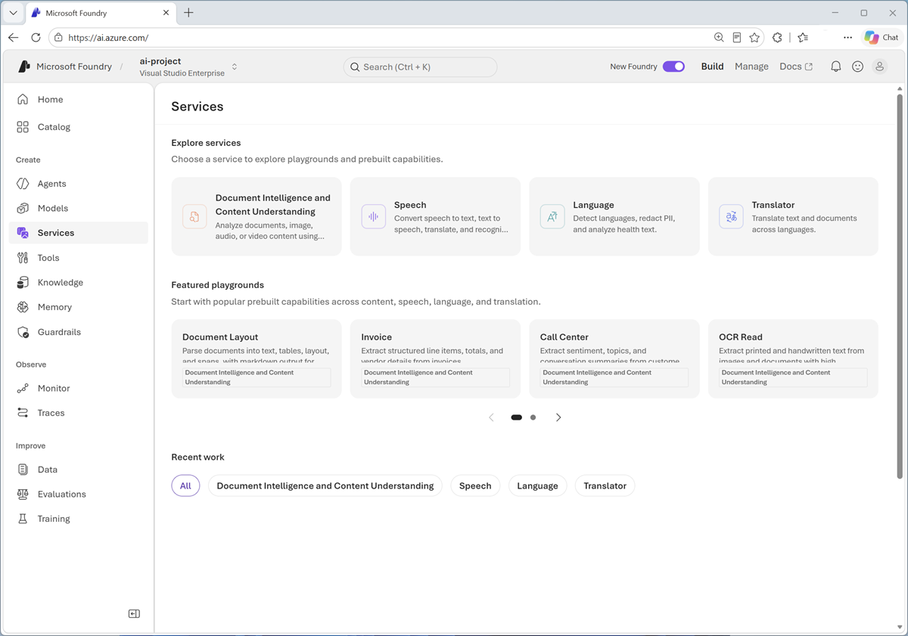
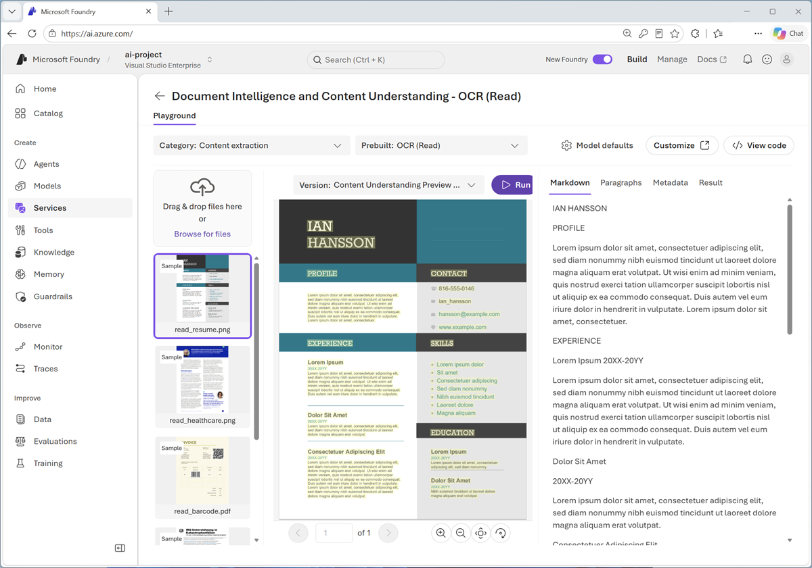
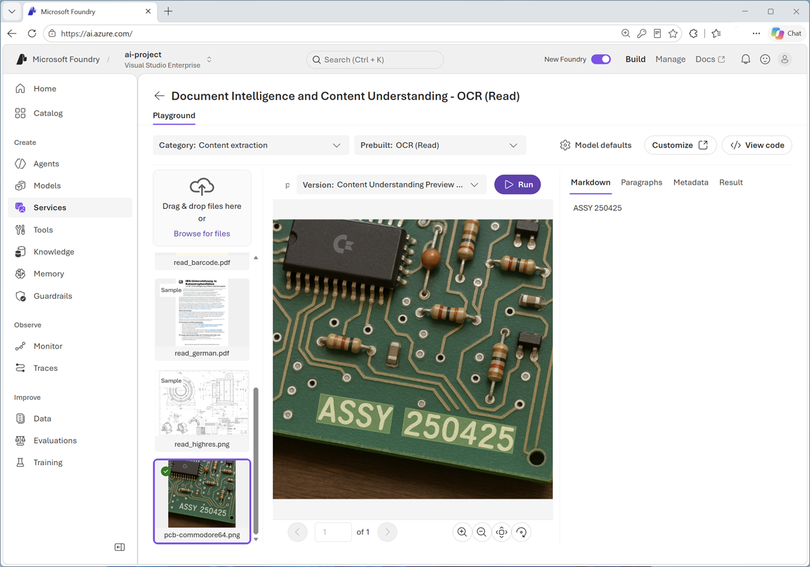
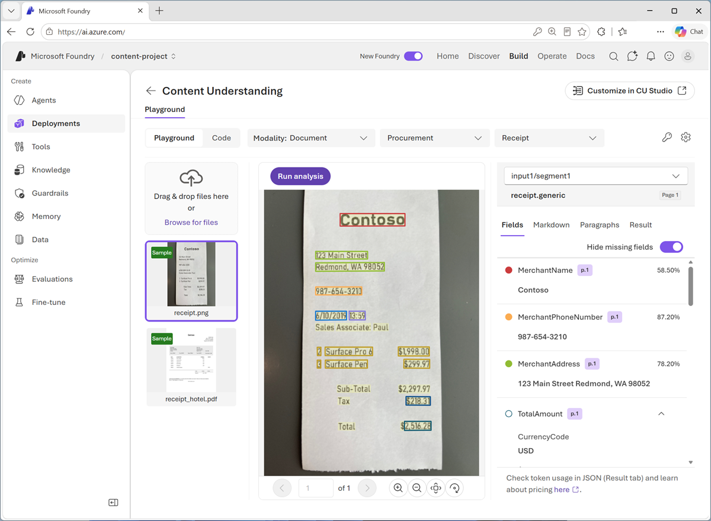

---
lab:
  title: Get started with information extraction in Microsoft Foundry​
  description: Use AI models to extract information from visual data.
  level: 200
  duration: 25 minutes
  islab: true
  primarytopics:
    - Microsoft Foundry
---

# Get started with information extraction in Microsoft Foundry

<br/>**Hi, I'm Anton.**<br/>I'll be here to help you with hints and tips as you work through this lab, in which you'll use Azure Content Understanding in Foundry to extract data from images.

If you want more interactive help, you can chat with me in the *[Ask Anton](https://aka.ms/choose-anton){:target="_blank"}* app.

<details>
<strong><i><a href="https://aka.ms/choose-anton" target="_blank">Ask Anton</a></i></strong> is a generative AI agent that can answer questions about AI concepts and Microsoft Foundry technologies. It's available in two versions at <code>https://aka.ms/choose-anton</code>:
<ul>
<li><strong>Azure-based</strong>: Best experience <i>(requires an Azure subscription and deployment of a model in a Foundry project)</i>.</li>
<li><strong>Browser-based</strong>: Use a small language model in your browser <i>(reduced functionality - may be slow or work only in "basic" mode in older/lower-spec devices)</i>.</li>
</ul>
<blockquote><i>Ask Anton is <u>not</u> a supported Microsoft product or a component of Microsoft Learn or AI Skills Navigator.</i>
</blockquote>
</details>
<hr/>

This exercise takes approximately **25** minutes.

## Create a Microsoft Foundry project

1. In a web browser, open [Microsoft Foundry](https://ai.azure.com){:target="_blank"} at `https://ai.azure.com` and sign in using your Azure credentials. Close any tips or quick start panes that are opened the first time you sign in, and if necessary use the **Foundry** logo at the top left to navigate to the home page.
1. If you do not have any existing projects, you may be prompted to create one. If so, create a new project with a unique name; expanding the  **Advanced options** area to specify the following settings for your project:
    - **Foundry resource**: *Enter a valid name for your AI Foundry resource.*
    - **Subscription**: *Your Azure subscription*
    - **Resource group**: *Create or select a resource group*
    - **Region**: Select *West US*, *Sweden Central*, *Australia East*, or any of the regions in [this list](https://learn.microsoft.com/azure/foundry/openai/how-to/responses#supported-regions){:target="_blank"}

    > <br/>**Tip**: Depending on your permissions in the Azure subscription, you may need to clear the option to set up recommended resources.

1. Wait for your project to be created, and close any welcome dialogs that are displayed. It may take a few minutes. After creating or selecting a project in the new Foundry portal, it should open in a page similar to the following image:

    

## Use *Content Understanding* to extract information from documents

Azure Content Understanding is a Foundry service that uses AI models to turn unstructured, multimodal content (documents, images, video, audio) into structured, usable outputs like JSON. It processes content by extracting, classifying, and generating fields with confidence scores and source grounding.

### Use OCR to read text in an image

Suppose you want to find information related to a piece of computer hardware or some other item with information printed on it. A first step might be to digitize the text so you can use it to look up details on the Internet or in an AI assistant. You can use an AI technique called optical character recognition (OCR) to "read" text in images.al

1. In the Foundry portal, navigate to the tool bar at the top of the screen and select **Build**.
1. On the *Build* page, in the menu on the left-side of the screen (which you may need to expand), select the **Services** page.

    Microsoft Foundry Tools includes multiple AI Services (formerly known as Microsoft Cognitive Services) that support common speech, translation, language, and content understanding workloads.

    

1. Select **Document Intelligence and Content Understanding**, and then select the **OCR (Read)** analyzer.

1. Select any sample image, and use the **Run** button to extract text from it. When analysis is complete, view the results.

    

1. In the pane on the right, review the **Markdown**, **Paragraphs**, and **Result** tabs to see the data that has been read from the document by the analyzer.

1. In a new browser tab, download **[pcbs.zip](https://aka.ms/pcb-images){:target="_blank"}** from `https://aka.ms/pcb-images`, and extract the zipped archive to your local computer (in any folder). These files are images of printed circuit boards that contain text.
1. Upload any of the PCB images, and view it in the main content area of the app.
1. Run analysis on the uploaded image and review the results.

    

1. Repeat the process to analyze the other PCB images you downloaded.

    > <br/>**Tip**: Try uploading any images that contain legible text.

    The *OCR/Read* analyzer extracts text from images. However, sometimes it may be useful to extract additional information about the *layout* of the text in the image.

1. In the list of analyzers, select **Layout**. Then select any of the sample images and use the **Run analysis** button to extract information from it. When analysis is complete, review the **Markdown**, **Paragraphs**, **Tables**, and **Result** tabs to see the ways in which the layout of the data in the document has been interpreted by the analyzer.

    Extacting the text and page layout is useful when the documents need to scan have a consistent, well-defined structure. In many cases though, you need to be able to identify which text values map to which data fields; so a more specific analyzer is needed.

### Extract fields from documents

Now suppose you need to extract data fields from scanned receipts to help automate an expense claim solution. You can use OCR to identify text and its location in images, and then use a generative AI model to associate individual text values with specific data fields - such as company names, phone numbers, dates, amounts, and so on.

1. In the **Category** list, select **Procurement**, and then select the **Receipt** analyzer.

    > <br/>**Tip**: Field extraction requires a custom model, so you may be prompted to deploy models during this process. Click **Cancel** when this happens.<br><br>Do <u>not</u> run analysis - we'll review the pre-prepared analysis results.

    

1. In the pane on the right, review the **Fields**, **Markdown**, **Paragraphs**, and **Result** tabs to see the data extracted from the document by the analyzer.

    The **Fields** tab displays a user-friendly version of the information from the raw JSON in the **Results** tab, which is how a client application would receive the results of analysis.

## Understand how to extract content with the Python SDK

As a developer, you can also use code to extract meaning from content. The Foundry playground provides various code samples to get you started with information extraction with Azure Content Understanding.

1. Let's take a closer look at the Python code for document layout analysis. In the Content Understanding playground, while viewing the results of the **Receipt** analyzer, select **View Code** tab. The following code is provided:

    ```python  
    """
    A sample to demonstrate analyzing with Azure AI Content Understanding Python SDK.

    Requirements:
        - Python 3.9 or later

    Setup:
        Follow the steps in the URL below to configure your Microsoft Foundry resource and model deployments:
        https://github.com/Azure/azure-sdk-for-python/tree/main/sdk/contentunderstanding/azure-ai-contentunderstanding#configuring-microsoft-foundry-resource

    Configuration:
        Before running, update the following variables in the script:
        - AZURE_CONTENT_UNDERSTANDING_ENDPOINT: The endpoint to your Content Understanding resource.
        - CONTENT_UNDERSTANDING_KEY: Your Content Understanding API key (optional if using DefaultAzureCredential).
        - FILE_URL: URL of the file to analyze.

    Usage:
        1. Navigate to the directory containing this file:
        # In your terminal
        cd path/to/the/directory/containing/this/file

        2. (Optional) Create and activate a virtual environment:
        python -m venv .venv         # One time setup
        source .venv/bin/activate      # On Linux/macOS
        .venv\\Scripts\\activate        # On Windows

        3. Install dependencies:
        python -m pip install --pre azure-ai-contentunderstanding
        python -m pip install azure-identity

        4. Run the script:
        python sample.py
    """

    import json
    from urllib.parse import urlparse
    from azure.ai.contentunderstanding import ContentUnderstandingClient
    from azure.ai.contentunderstanding.models import AnalysisInput, AnalysisResult
    from azure.core.credentials import AzureKeyCredential
    from azure.core.exceptions import AzureError
    from azure.identity import DefaultAzureCredential


    def is_absolute_url(value: str) -> bool:
        parsed_url = urlparse(value)
        return bool(parsed_url.scheme and parsed_url.netloc)


    def main() -> None:
        # Insert the following configurations.
        # 1) AZURE_CONTENT_UNDERSTANDING_ENDPOINT - the endpoint to your Content Understanding resource.
        endpoint = "https://ai-resrce.services.ai.azure.com/"

        # 2) CONTENT_UNDERSTANDING_KEY - your Content Understanding API key (optional if using DefaultAzureCredential).
        key = "{{CONTENT_UNDERSTANDING_KEY}}"

        # 3) FILE_URL - you can replace this with your own URL.
        file_url = "{{FILE_URL}}"

        # ANALYZER_ID - the ID of the analyzer to use.
        analyzer_id = "prebuilt-receipt"

        # API_VERSION - the API version to use.
        api_version = "2026-06-01-preview"

        # Validate Endpoint
        if not is_absolute_url(endpoint):
            print("[Error] Invalid Endpoint. Please provide a valid 'Endpoint'.")
            return

        # Validate File URL
        if not is_absolute_url(file_url):
            print("[Error] Invalid File URL. Please provide a valid URL.")
            return

        # Set up Content Understanding client.
        hasKey = type(key) is str and bool(key.strip()) and "{{CONTENT_UNDERSTANDING_KEY}}" not in key
        credential = AzureKeyCredential(key) if hasKey else DefaultAzureCredential()
        client = ContentUnderstandingClient(endpoint=endpoint, credential=credential, api_version=api_version)

        # [START analyze]
        print(f"Analyzing with {analyzer_id} analyzer...")
        print(f"  File URL: {file_url}\n")

        try:
            poller = client.begin_analyze(
                analyzer_id=analyzer_id,
                inputs=[AnalysisInput(url=file_url)],
            )
            result: AnalysisResult = poller.result()
        except AzureError as err:
            print(f"[Azure Error]: {err.message}")
            return
        except Exception as ex:
            print(f"[Unexpected Error]: {ex}")
            return
        # [END analyze]

        # [START output_result]
        print("=" * 50)
        print("Analysis result:")
        print("=" * 50 + "\n")

        max_display_lines = 50
        result_str = json.dumps(result.as_dict(), indent=2)
        ret_lines = result_str.splitlines()

        if len(ret_lines) > max_display_lines:
            print("\n".join(ret_lines[:max_display_lines]))
            print(f"\n {len(ret_lines) - max_display_lines} more lines to be displayed...\n")
        else:
            print(result_str)
        # [END output_result]


    if __name__ == "__main__":
        main()
    ```

    The code connects to the Content Understanding tool in your Foundry resource, and submits a document file to the *prebuilt-receipt* analyzer. The analyzer runs asynchronously, and returns the results of the analysis in the JSON format you saw in the **Result** tab.

## Summary

In this exercise, you explored Azure Content Understanding in Foundry and learned how it transforms unstructured content into structured, usable data. You tried out three analyzers, each building on the previous one in capability:

- **Read**: Extracts raw text from documents without interpreting structure or meaning.
- **Layout**: Goes a step further by capturing structure and hierarchy.
- **Receipt**: A document -specific analyzer that uses a combination of capabilities to extract text values and map them to data fields.

You also learned how developers can integrate Content Understanding into applications using the **Python SDK**, which enables programmatic analysis of documents outside the Foundry playground.

## Clean up

If you’ve finished working with the Content Understanding service, you should delete the resources you have created in this exercise to avoid incurring unnecessary Azure costs.

1. Open the **Azure portal** at [https://portal.azure.com](https://portal.azure.com) and select the resource group that contains the resources you created.
1. Select **Delete resource group** and then **enter the resource group name** to confirm. The resource group is then deleted.

> <br/>If you used the [*Ask Anton*](https://aka.ms/choose-anton){:target="_blank"} app during this lab, we'd love you to [tell us about your experience with it](https://forms.office.com/r/fC0ndfBQeK){:target="_blank"}!
